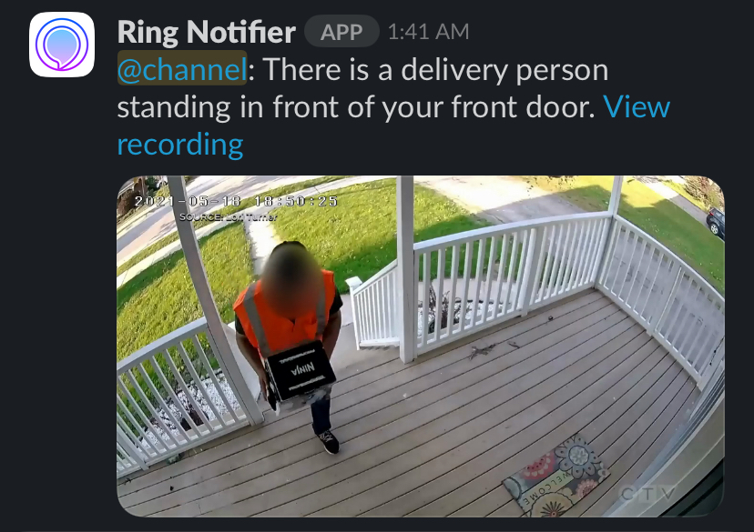
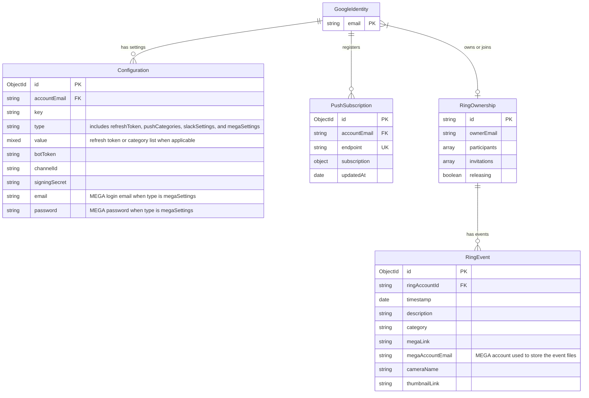

# Ring Doorbell Notifier
Simple, Gemini AI-powered ([Gemini](https://ai.google.dev/gemini-api/docs/models/gemini)) nodejs app that will let you skip the expensive subscription and
- Record motion videos directly on your **Mega drive**. Mega because it is the easiest and offers the best amount of free storage
- Serve recorded events, video streams, and JPEG previews to the A-Eye frontend.
- Serve Ring camera snapshots and battery levels and signal WebRTC live views and camera-speaker activation for the A-Eye Live tab; sessions expire automatically after five minutes and are stopped when the viewer leaves. Battery camera snapshots are cached by the Ring client for up to ten minutes to reduce battery drain.
- Send notification to **Slack** with the recorded video attached when motion is detected.
- Use AI to describe what your camera is seeing
- With this you can enjoy pretty much the same premium features of ring doorbells for totally FREE.


## Database diagram

The app stores data in MongoDB collections for account configuration, administrators, Ring ownership, video events, and browser push subscriptions. `pushCategories` and `megaSettings` are account-scoped records in the `configuration` collection, not separate collections. MEGA credentials are stored in the Ring owner's `megaSettings` record; each video event records the MEGA account email used for its files. `GoogleIdentity` is a logical account reference rather than a collection; ownership participants and push subscription data are stored within their respective documents.

<!-- mermaid-checked: every attribute is `<type> <name> [<key>] ["<description>"]` with at most one of PK/FK/UK, no \n in descriptions, no {} in descriptions, every relationship label is double-quoted -->


## How to run locally
- Install Node.js 22 or newer. Install FFmpeg if you want video thumbnails.
- Copy `.env.sample` to `.env` and set `MONGO_DB_CONNECTION_STRING`, `SESSION_SECRET`, `GOOGLE_CLIENT_ID`, `GOOGLE_CLIENT_SECRET`, `GOOGLE_ALLOWED_ORIGINS`, and `A_EYE_SESSION_SECRET`. Register each allowed origin's `/auth/google/callback` URL as a Google OAuth redirect URI.
- Run `npm install`, then `npm start`. The backend listens on `APP_SERVER_PORT` (default `3600`).
- Sign in through A-Eye and configure MEGA under **Settings → Storage** before storing video uploads.
- A-Eye administrators are separate from Google Cloud IAM. The bootstrap admin defaults to `daniel.voaviarison@gmail.com`; set `A_EYE_ADMIN_EMAILS` to a comma-separated list to override it. Admins can add verified Google account emails through the Admin tab; these grants persist in MongoDB's `administrators` collection. Added users see the tab after signing in or refreshing. Admins can view all Ring tenants and invitees and add other admins. The app's capture endpoint requires an admin Google session, except for valid account-bound Slack commands.
- Each incoming request and its completion are logged with a request ID, method, route template, status, and duration. Failed responses and interrupted requests are logged as errors; query strings, bodies, and route parameter values are not logged.
- Ring notifications are claimed by account and event ID in MongoDB before processing, so repeated deliveries and restarts do not trigger the same event again. A failure after a claim is logged but not automatically retried.
- Live recordings use an enlarged FFmpeg RTP reorder queue and receive buffer to help with bursty or out-of-order video packets, including higher-bitrate 2K streams. Buffering cannot recover packets lost before they reach the recorder and may add latency.

## How to run with Docker Compose
- Copy `.env.sample` to `.env` and fill in the required values, including `MONGO_DB_CONNECTION_STRING` and a long random `SESSION_SECRET`.
- From the project directory, build and start the app:
```sh
docker compose pull
docker compose up -d
```
- Compose pulls the latest published image from Docker Hub. The published image supports `amd64` and 64-bit Raspberry Pi (`arm64`). Watchtower checks for updates every five minutes and restarts the app when a new image is available. Open `http://<raspberry-pi-address>:<APP_SERVER_PORT>` (default port `3600`). Recordings are kept in a Docker-managed volume.
- The Compose service uses the maintained `nickfedor/watchtower` image; the original `containrrr/watchtower` image may use a Docker API client too old for current Docker Engine versions.
- Watchtower requires access to `/var/run/docker.sock` so it can update containers. This grants it broad control over the Docker host; only use this configuration on a trusted machine.
- To view logs or stop the app:
```sh
docker compose logs -f
docker compose down
```
- To create a linux build and push to dockerhub. You then can deploy it in a free host like [railway](https://railway.app/dashboard) or [render](https://dashboard.render.com). Replace your username and the tag (e.g. v1.2.0)
```sh
docker buildx build --platform linux/amd64 -t username/ring-doorbell-notifier:tag .
docker push username/ring-doorbell-notifier:tag
```

Pushes to `main` automatically build and publish `dvoaviarison/ring-doorbell-notifier` to Docker Hub, starting with version `v3.0.0`. Add repository Actions secrets named `DOCKERHUB_USERNAME` and `DOCKERHUB_TOKEN` with your Docker Hub credentials (prefer an access token). The image is tagged with the `v`-prefixed GitVersion semantic version, `latest`, and the commit SHA. After a successful image push, the workflow creates a matching GitHub Release with automatically generated release notes. The separate Render deployment job targets the `render-production` GitHub Environment, so it can be held for reviewer approval before deploying the exact new image tag. Create that Environment in repository settings, configure required reviewers, and add its `RENDER_DEPLOY_HOOK_URL` environment secret containing the image-backed Render service's deploy hook URL. Configure the Render service to use `docker.io/dvoaviarison/ring-doorbell-notifier` and ensure Render has credentials to pull the Docker Hub image if it is private. GitVersion derives version increments from commit messages: `feat:` is a minor release, `fix:`, `perf:`, and `refactor:` are patch releases, and `BREAKING CHANGE:` or `!` after a Conventional Commit type is a major release. You can also use `+semver: major`, `+semver: minor`, or `+semver: patch`.

## Troubleshooting
Sometimes the notifications do not work. Here are some suggestions
- Reconnect the Ring account through A-Eye or the Ring authentication endpoints.
- If the notification from ring is working but not for this app, go to the ring app > Control Center and remove all trusted devices
- If all notifications stopped even for the ring app, remove the doorbells from your account and add them back
