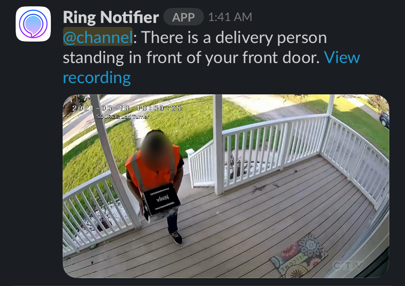

# Ring Doorbell Notifier
Simple, Gemini AI-powered ([Gemini](https://ai.google.dev/gemini-api/docs/models/gemini)) nodejs app that will let you skip the expensive subscription and
- Record motion videos directly on your **Mega drive**. Mega because it is the easiest and offers the best amount of free storage
- Serve recorded events, video streams, and JPEG previews to the A-Eye frontend.
- Send notification to **Slack** with the recorded video attached when motion is detected.
- Use AI to describe what your camera is seeing
- With this you can enjoy pretty much the same premium features of ring doorbells for totally FREE.


## How to run this locally
- Configure Google OAuth on this backend: set `GOOGLE_CLIENT_ID`, `GOOGLE_CLIENT_SECRET`, `GOOGLE_ALLOWED_EMAILS` (comma-separated), `GOOGLE_ALLOWED_ORIGINS` (comma-separated frontend origins), and `A_EYE_SESSION_SECRET` (at least 32 random bytes; generate with `openssl rand -hex 32`). Register each allowed origin's `/auth/google/callback` URL as an authorized redirect URI in Google Cloud, for example `http://localhost:5173/auth/google/callback` and `https://a-eye-home.onrender.com/auth/google/callback`. Use the same OAuth web client for both origins. HTTPS is required except for localhost.
- Google sign-in protects Swagger and API routes, including Ring sign-in. `/health` and valid signed Slack requests remain available without a Google session. To access Swagger directly, add the backend's browser origin to `GOOGLE_ALLOWED_ORIGINS`, register its `/auth/google/callback` URL with Google, and visit `/auth/google` at that origin. After signing in, `/` redirects to Swagger at `/api-docs/`. A request without a Google session returns HTTP 401.
- Fill in the required variables in `.env.sample` and save a copy as `.env`. Set `MONGO_DB_CONNECTION_STRING` and a long random `SESSION_SECRET` for Ring login. `MONGO_DB_EVENTS_COLLECTION_NAME` selects the MongoDB collection for Mega upload events (default: `events`). Each successfully uploaded video is recorded with its UTC timestamp, camera name, event description (without the camera name or Slack `@channel` prefix), and Mega link; the thumbnail link is included when thumbnail generation and upload succeed. The `@channel` prefix is added separately for Slack notifications. On Render, set `SESSION_SECRET` under the service's **Environment** settings; without it the app uses a temporary random secret, so sessions are invalidated whenever the server restarts.
- The Gemini video-description prompt is defined in `src/helpers/aiHelper/prompts.mjs`, not in an environment variable or user setting. Deploy the updated backend image before removing `APP_AI_USER_PROMPT` from an existing deployment, since older images still require it.
- Gemini returns a JSON description and category (`delivery`, `vehicle`, `person`, `animal`, or `uncategorized`). The category is saved with each event and returned by `/events`; it is null if AI is disabled or fails, and may be absent from older events. Older category names are translated when read. Slack and push notifications continue to use the description text.
- Use Node.js 22 or newer for Ring push notifications. The Docker image uses Node 22 and pins the Ring push receiver to a version that correctly parses Ring's notification encryption headers.
- Install FFmpeg on the host when running outside Docker; it is used to create each event's JPEG thumbnail. Set `FFMPEG_PATH` if the executable is not named `ffmpeg` or is not on `PATH`. Thumbnail generation is best-effort, so a failed extraction or upload does not prevent saving the video event.
- Run `npm install` then `npm start`
- The app automatically reuses the Ring refresh token saved in MongoDB when it remains valid. To connect or reconnect, sign in through A-Eye or use the Ring login and MFA endpoints in Swagger. MongoDB is the source of truth for the token, including in container deployments where filesystems may be ephemeral.
- Use HTTPS outside your local machine so Ring credentials and session cookies are protected in transit.
- To enable browser push notifications, generate a VAPID key pair with `npx web-push generate-vapid-keys` and set `WEB_PUSH_VAPID_PUBLIC_KEY`, `WEB_PUSH_VAPID_PRIVATE_KEY`, and `WEB_PUSH_VAPID_SUBJECT` in the server environment (for example, `mailto:admin@example.com`). Keep the private key secret stable; changing it requires browsers to subscribe again. Configure subscriptions through A-Eye. Push notifications are sent after a video is uploaded and its event is saved.

## How to run as a service using forever
- Install forever: `npm install forever -g`
- Run `npm run start-service`
- To stop the process: `npm run stop-service`
- To view running services: `npm run list-services`
By running as a service, the app would auto-restart in case of crash.

## How to run with Docker Compose
- Copy `.env.sample` to `.env` and fill in the required values, including `MONGO_DB_CONNECTION_STRING` and a long random `SESSION_SECRET`.
- From the project directory, build and start the app:
```sh
docker compose pull
docker compose up -d
```
- Compose pulls the latest published image from Docker Hub. The published image supports `amd64` and 64-bit Raspberry Pi (`arm64`). Watchtower checks for updates every five minutes and restarts the app when a new image is available. Open `http://<raspberry-pi-address>:<APP_SERVER_PORT>` (default port `3600`). Recordings are kept in a Docker-managed volume.
- The Compose service uses the maintained `nickfedor/watchtower` image; the original `containrrr/watchtower` image may use a Docker API client too old for current Docker Engine versions.
- Watchtower requires access to `/var/run/docker.sock` so it can update containers. This grants it broad control over the Docker host; only use this configuration on a trusted machine.
- To view logs or stop the app:
```sh
docker compose logs -f
docker compose down
```
- To create a linux build and push to dockerhub. You then can deploy it in a free host like [railway](https://railway.app/dashboard) or [render](https://dashboard.render.com). Replace your username and the tag (e.g. v1.2.0)
```sh
docker buildx build --platform linux/amd64 -t username/ring-doorbell-notifier:tag .
docker push username/ring-doorbell-notifier:tag
```

Pushes to `main` automatically build and publish `dvoaviarison/ring-doorbell-notifier` to Docker Hub, starting with version `v3.0.0`. Add repository Actions secrets named `DOCKERHUB_USERNAME` and `DOCKERHUB_TOKEN` with your Docker Hub credentials (prefer an access token). The image is tagged with the `v`-prefixed GitVersion semantic version, `latest`, and the commit SHA. After a successful image push, the workflow creates a matching GitHub Release with automatically generated release notes. The separate Render deployment job targets the `render-production` GitHub Environment, so it can be held for reviewer approval before deploying the exact new image tag. Create that Environment in repository settings, configure required reviewers, and add its `RENDER_DEPLOY_HOOK_URL` environment secret containing the image-backed Render service's deploy hook URL. Configure the Render service to use `docker.io/dvoaviarison/ring-doorbell-notifier` and ensure Render has credentials to pull the Docker Hub image if it is private. GitVersion derives version increments from commit messages: `feat:` is a minor release, `fix:`, `perf:`, and `refactor:` are patch releases, and `BREAKING CHANGE:` or `!` after a Conventional Commit type is a major release. You can also use `+semver: major`, `+semver: minor`, or `+semver: patch`.

## Troubleshooting
Sometimes the notifications do not work. Here are some suggestions
- Reconnect the Ring account through A-Eye or the Ring authentication endpoints.
- If the notification from ring is working but not for this app, go to the ring app > Control Center and remove all trusted devices
- If all notifications stopped even for the ring app, remove the doorbells from your account and add them back
